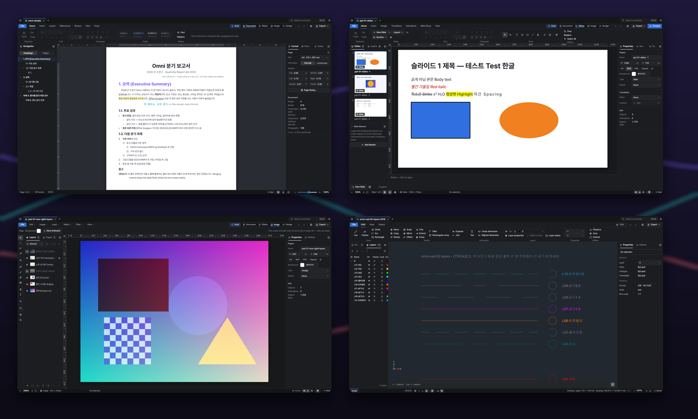
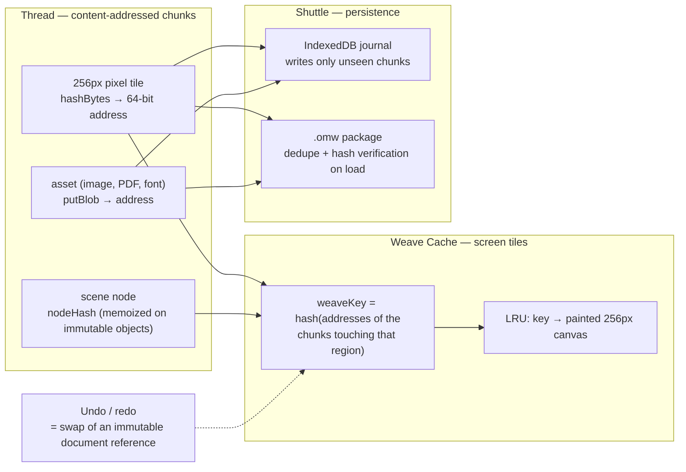

<div align="center">

# Omniweave

**A local 6-in-1 editor that doesn't break your originals — a ~17 MB install, and your files are never uploaded anywhere.**

Raster, vector (AI), PDF, documents (DOCX, HWPX), slides, spreadsheets — and PSD and DWG/DXF drawings.
Open, edit and save them on one canvas.

[**Try it now — no install**](https://wind2sp.github.io/omniweave/app/?demo) · [Download](https://wind2sp.github.io/omniweave/en/download.html) · [한국어](README.md) · [Concept](docs/CONCEPT.md) · [Loom engine](docs/LOOM.md) · [Contributing](CONTRIBUTING.md)
<!-- The browser demo link works once GitHub Pages deploys the web app under /app/. The website button is switched on with demoPublic in website/config.json. -->

[](LICENSE)
[](#quick-start)
[](https://www.typescriptlang.org/)
[](https://tauri.app/)



</div>

> **Status: first public preview (v0.2.0).** The UI is available in Korean, English, Japanese and Simplified Chinese. Keep a copy of important originals.
> Only implemented features and **measured** numbers are stated below; ongoing work is marked **in progress** or **roadmap**. Limits come first in the [honest FAQ](#faq-the-honest-version).

*Omniweave is called "오메" (Omé, "Oh-meh") in Korean — a Jeolla-dialect exclamation like "Oh my!", and the first letters of OMniweave.*

---

## Proof, not adjectives

| | What | Evidence |
|---|---|---|
| **~17 MB installer** | Windows x64 `Omniweave_0.2.0_x64-setup.exe` = 17,464,150 bytes (0.2.0 build before code signing, with the AI models for upscaling, background removal and text recognition). Rendering uses WebView2, which ships with Windows. | Build artifact size; may change per release |
| **91 real-world samples** | **0** failed to open or hung — every one succeeded, opened partially, or showed why it cannot be opened | Pre-release check 2026-11-22 (counts only; file contents and names are not published) |
| **Local processing** | Opening, editing, saving, converting and the quick tools all run on your PC. The network is used only to check for new versions (GitHub Releases). | Open source — verify it yourself |
| **Encrypted documents stay encrypted** | Open PDF (AES-256), DOCX/XLSX/PPTX (Office Agile) and `.omw` (AES-256-GCM), edit, and save re-encrypted. Re-encrypted Office files were verified to open in Microsoft Office 16. | Implemented |
| **History timeline** | Every command since you started is recorded; preview any point and jump back in one step. Saved inside the `.omw`. | Implemented |
| **40+ file extensions** | Documents, spreadsheets, slides, images, PSD, video, audio, e-books, text and code — each with its support level (full, partial, or an explanation). | Implemented |
| **6 quick tools (local)** | Merge PDFs · shrink PDFs · PDF→JPG · images→PDF · shrink photos · batch JPG conversion | Implemented |
| **Lossless save of originals** | Saving back to the original format without changes writes the original bytes; an edit rewrites only what changed | Tests: every DOCX, HWPX, XLSX, PPTX and PDF sample in the repository; PSD 259/259 (2 of 3 real-world samples) |
| **Loom engine benchmarks** | 79.5% tile dedupe, 0.08–0.18 ms undo, … | [Measurements](#measurements), reproduce with `npm run bench` |

"Partial" means some content was approximated or left out (some PSD effects, some PPTX shapes, …); the "unsupported" ones are HEIC photos and some AVI videos (no decoder in the built-in browser engine) and a PDF that needs its open password — each with an explanation shown to the user.

---

## Why

Image editors, illustration tools, PDF editors, word processors, presentation programs.
Different names, different vendors — yet the work inside them is remarkably similar:

- **place images and text,**
- **draw shapes and lines,**
- **adjust the properties of the selected object** (position, size, colour, opacity, font).

"Pages or layers?", "vector or bitmap?" — these are differences in **how the result is finally stored**.
While you load and edit, they don't matter. When you need the original format, you export to it.

Yet finishing one piece of work still means hopping between six programs, pasting the same logo six times,
re-fitting the same paragraph six different ways — uploading files to one website after another, and watching the original formatting break.

## Manifesto

> **File formats are exits. Editing happens in one scene graph. Originals stay on your PC, intact.**

1. **One model.** Raster tiles, Bézier paths, text paragraphs, tables, PDF pages, images and video are all *scene-graph nodes*. Selection, moving, opacity, ordering and undo behave identically for every object.
2. **Formats live only at the edges.** DOCX, HWPX, PDF, PPTX and PSD become nodes on the way in and are written back on the way out.
3. **Don't break the original.** The principle is that parts you didn't edit are saved as in the original (PDF and PSD in progress, DOCX and HWPX on the roadmap). What can be lost today is listed in the [FAQ](#faq-the-honest-version).
4. **Your files stay on your PC.** No uploading to a server to convert, compress or merge.
5. **Depth is where we compete.** The goal is to handle all six formats deeply enough for real work, not just "it opens". Coverage is published in [docs/coverage](docs/coverage/REPORT.md).

The full philosophy and per-format mapping tables are in [docs/CONCEPT.md](docs/CONCEPT.md) (Korean).

---

## 6-in-1 modules (+ PSD)

| Module | What it does (implemented) |
|---|---|
| **Raster** | 256 px tile brush and eraser (pressure, hardness, opacity). Open **PSD**: pixel layers + composite (effects, adjustment layers and the text engine excluded). Open TIFF, WebP, AVIF and more |
| **Vector** | Pen (Bézier handles), direct selection, rectangle/ellipse, pathfinder unite/subtract/intersect/exclude. Open **AI** files (saved with PDF compatibility) |
| **PDF** | Page rendering via pdf.js, **elevate** text into editable line-level objects, open and re-encrypt password-protected PDFs (AES-256), quick tools (merge, shrink, convert to JPG) |
| **Documents** | Open and save DOCX paragraph and character formatting, edit table objects and save them to DOCX, A4 pagination. Legacy DOC: body and table text |
| **Hangul documents** | Open and save HWPX (clean-room, from the public OWPML structure). Legacy HWP (5.0): body and table text |
| **Slides** | Open and save PPTX (text, shapes, pictures, tables, backgrounds), masters, transitions FADE / SLIDE_LEFT / ZOOM, keyframe animation, full-screen slideshow |

**Shared:** the same selection, transform (move/scale/rotate), opacity, blend mode, lock, hide, z-order and undo for every object, plus the history timeline.
**Also opens:** XLSX, XLS, CSV (tables), Markdown, HTML, EPUB (documents), SRT (subtitles), video and audio (playback on canvas and in slideshows), text, code and config files.
**Export:** PNG · PDF · SVG · DOCX · HWPX · PPTX · XLSX · CSV · Markdown · HTML · SRT · native `.omw`.
**Korean typography:** line breaking on grapheme clusters via `Intl.Segmenter` (Hangul jamo never split), and `keep-all` breaking between eojeol (Korean word units).

---

## The Loom engine

Omniweave's document core is a purpose-built engine called **Loom**. One idea: *address everything by its content.*



| Part | What it does | Why it matters |
|---|---|---|
| **Thread** | Pixel tiles, nodes and assets each carry a 64-bit content address (`src/core/hash.ts`, `src/core/loom.ts`) | Identical tiles are stored once. On load every chunk is re-hashed; corrupt chunks are skipped and the rest of the document still opens |
| **Weave Cache** | A screen tile's key is the hash of the addresses of the chunks touching it (`weaveKey`, `src/render/weave.ts`) | A brush stroke repaints only the screen tiles it touched. **There is no dirty flag or invalidation code**, so the "stale pixels left behind" class of bug cannot occur by construction. Undo and page switches reuse earlier tiles |
| **Shuttle Journal** | Incremental autosave to IndexedDB, writing only chunks it has not written before (`src/io/journal.ts`) | Light autosave and crash recovery |
| **Immutable history** | Undo/redo swaps an immutable document reference (`src/core/store.ts`) | No pixel copies; cost does not grow with document size |

Technical details and limits (the hash is a non-cryptographic 64-bit hash, etc.) are in [docs/LOOM.md](docs/LOOM.md), with code references.

## Measurements

From `bench/loom.bench.ts` (Vitest bench, Node, DOM-free code paths only). Measured on **synthetic documents**; real documents will differ.
Ranges of the mean across two runs on the same machine (other work was running, so variance is high).

- Machine: Intel(R) Core(TM) Ultra 5 125H (18 logical cores), Windows 11, Node v24.13.1, Vitest 2.1.8
- Reproduce: `npm run bench`

| What | Setup | Result (mean) |
|---|---|---|
| Tile hash `hashBytes` | one 256×256 RGBA tile (256 KiB) | 0.24–0.25 ms per tile (≈1 GiB/s) |
| Tile dedupe | synthetic 4K doc: 205 tile references (135 white paper + 40 painted + 30 of one stamp) | 42 unique tiles → **79.5% of tile payload removed** |
| Size | same document | raw RGBA 51.3 MiB → 10.5 MiB after dedupe → `.omw` 1.43 MiB |
| `packOmw` | save that document (incl. zip level 6) | ≈760–780 ms |
| `unpackOmw` | open that document (**re-verifies every tile hash**) | ≈0.1–0.3 s (high variance) |
| Round-trip integrity | save → open | 0 corrupt · 0 missing · document root address matches |
| `weaveKey` | 1920×1080 page, 40 screen tiles, 31 nodes — all keys for one frame | ≈0.36–0.43 ms per frame |
| `weaveKey` | right after one brush tile changed (incl. new node objects) | ≈0.44 ms per frame |
| Undo + redo | small doc / synthetic 4K doc | 0.08–0.09 ms / 0.09–0.18 ms |
| (contrast) `structuredClone` | deep copy of the 4K doc — what a copy-based undo would pay | 24–28 ms |

> Canvas painting itself needs a browser and is not part of this benchmark. Screen-tile count, cache hit rate and render time are shown live by the **Loom meter** in the status bar (`WeaveStats`).

---

## Download and install

[**Get it from GitHub Releases**](https://github.com/wind2sp/omniweave/releases/latest) — Windows 10 (version 2004 or later) and Windows 11, x64. A Microsoft Store version is in preparation.

| File | What it is |
|---|---|
| `Omniweave_<version>_x64-setup.exe` | **Installer (recommended).** Installs into your user folder without admin rights; pick the UI language during setup. Associates `.omw` files. Updates itself |
| `Omniweave_<version>_x64-portable.exe` | Runs without installing. Updates itself (replaces the exe in place, same name and folder) |
| `SHA256SUMS.txt` | To check what you downloaded. PowerShell: `Get-FileHash .\Omniweave_<version>_x64-setup.exe` must match the value in this file |

- The window is drawn by WebView2, which is part of Windows 11 and current Windows 10; if it is missing, the installer downloads it during setup (internet needed).
- **"Windows protected your PC" / "Unknown publisher":** the files are not code-signed yet, so Windows may warn on first run. Check the file against the SHA-256 above, then choose **More info › Run anyway**. Code signing is in preparation (`docs/CODE_SIGNING.md`).
- **Automatic updates:** the installer and portable builds check GitHub Releases 4 seconds after start and every 6 hours, download a new version and verify it (signature; for the portable build also size, SHA-256 and a self-test), then show a notice in the title bar. Clicking it shows what changed; **Update now** installs it or swaps the exe and reopens the app. If the portable build's folder is not writable, the download page opens instead. The Microsoft Store version is updated by the Store, and the web (browser) version is updated by reloading the page. The app uses the internet for nothing else ([privacy policy](website/privacy.html)).
- **PCs with an earlier test build (0.1.13 or older)** need to install 0.2.0 once by hand; updates are automatic after that.
- macOS and Linux builds will be released after they have been verified on real machines.
## Quick start

Requires Node.js 18+. Desktop builds also need the [Rust toolchain](https://www.rust-lang.org/tools/install) and [Tauri 2 prerequisites](https://tauri.app/start/prerequisites/).

```bash
git clone https://github.com/wind2sp/omniweave.git
cd omniweave
npm i

npm run dev          # run in the browser → http://localhost:5199
npm test             # unit tests (Vitest)
npm run bench        # Loom engine benchmarks

npm run tauri dev    # desktop app (development)
npm run tauri build  # Windows installer (NSIS) with .omw file association
```

## The `.omw` format

`.omw` (Omniweave Workspace Package) is a zip container. Loading uses only `scene_graph.cbor` and the chunks;
everything else is a **readable mirror** for other tools (`src/io/omw.ts`).

```text
document.omw
├── mimetype                    "application/x-omniweave" (stored, first entry)
├── manifest.json               metadata, Loom root address, page index
├── scene_graph.cbor            unified scene graph (pixels replaced by tile addresses)
├── rasters/<hash>.raw          deduplicated 256×256 RGBA tiles (Loom threads)
├── assets/<hash>.<ext>         original images, PDFs, fonts
├── slides/slide_deck.json      slide order, transitions, animations (mirror)
├── slides/master_styles.json   slide masters (mirror)
├── vectors/paths.json          SVG path data of vector nodes (mirror)
├── documents/document.xml      every text paragraph (mirror)
└── documents/preview.txt       plain text for search/indexing
```

On load every tile and asset is re-hashed. Mismatching chunks are skipped and counted; the rest of the document opens normally.

## Keyboard shortcuts

| Action | Keys |
|---|---|
| New / Open / Save / Save as | `Ctrl+N` / `Ctrl+O` / `Ctrl+S` / `Ctrl+Shift+S` |
| Tools: select / direct select / hand / brush / eraser / pen / rectangle / ellipse / text | `V` / `A` / `H` / `B` / `E` / `P` / `R` / `O` / `T` |
| Brush size down / up | `[` / `]` |
| Undo / Redo | `Ctrl+Z` / `Ctrl+Y` or `Ctrl+Shift+Z` |
| Delete / Deselect | `Delete`·`Backspace` / `Esc` |
| Select all / Duplicate | `Ctrl+A` / `Ctrl+D` |
| Forward / Backward / To front / To back | `Ctrl+]` / `Ctrl+[` / `Ctrl+Shift+]` / `Ctrl+Shift+[` |
| Bold / Italic / Underline | `Ctrl+B` / `Ctrl+I` / `Ctrl+U` |
| Fit / 100% / Zoom in / Zoom out | `Ctrl+0` / `Ctrl+1` / `Ctrl+=` / `Ctrl+-` |
| Left dock / Right dock | `Ctrl+Alt+1` / `Ctrl+Alt+2` |
| Pan | `Space` + drag, mouse wheel (`Shift`+wheel = horizontal) |
| Zoom | `Ctrl` + wheel |
| Nudge selection | Arrow keys (`Shift` = 10 px) |
| Pen: finish / cancel path | `Enter` / `Esc` |
| Finish text editing | `Esc` or `Ctrl+Enter` |
| Start slideshow | `F5` |
| Slideshow: next / previous | `→` `↓` `Space` `Enter` `PageDown` `N` / `←` `↑` `Backspace` `PageUp` `P` |
| Slideshow: first / last / exit | `Home` / `End` / `Esc` |

> Defined in `src/ui/shell/shortcuts.ts` (global), `src/ui/CanvasView.tsx` (canvas) and `src/ui/Presenter.tsx` (slideshow). Global shortcuts are ignored while typing in a field (except `Ctrl+S`).

---

## FAQ (the honest version)

**Does it do everything the programs you use today do?**
No. Omniweave aims to be an integrated editor for many formats in one place, and **depth per format** is where it competes. Specialist features (advanced filters, print separations, equation editors, track changes, …) are out of scope today. Feature coverage per format is published as-is in [docs/coverage/REPORT.md](docs/coverage/REPORT.md).

**What exactly does "doesn't break your originals" mean?**
The direction is: **parts you didn't edit are saved exactly as in the original.** Today:
- **In progress:** original-preserving save for PDF and PSD (only edited pages/layers are rewritten; everything else is copied byte-for-byte).
- **Roadmap:** original-preserving (pass-through) save for DOCX and HWPX.
- **Now:** saving to DOCX/HWPX **writes a new document** from what Omniweave understood (paragraphs, character formatting, table objects). Elements such as footnotes and headers can be lost.
- Encrypted documents are re-encrypted when saved.

**Are my files really never uploaded?**
Yes. Opening, editing, saving, converting and the quick tools all run on your PC, and the autosave journal is local. The network is used only to check for new versions (GitHub Releases). The website has no tracking or analytics scripts either. The source is open, so you can verify it.

**Will DOCX/HWPX files look exactly like the original?**
Close to it: paragraph and character formatting, tables, pictures, sections, headers/footers, list and outline numbering, comments and tracked changes are laid out again along the original's page breaks (screen similarity SSIM 0.969 on average over 3 pages of a real-world DOCX sample). What can still differ:
- Documents using fonts that are not on the PC can break lines and pages differently.
- Equations and some drawing objects and text boxes. Drawing objects, text boxes and OLE objects of legacy DOC files are not imported, and the app says so when opening.
- Saving back to the original format without changes writes the original bytes, so a difference on screen does not change the saved file.

**Can I edit PDFs?**
Pages render as-is; "text elevation" turns the text into **line-level text objects** you can edit, covering the original glyphs with a sampled background-colour rectangle. Text over complex backgrounds and reflowing columns or tables are not supported yet.
PDF export writes a vector PDF with live text and shapes.

**How far do PPTX, legacy HWP and PSD go?**
- **PPTX:** opens text, shapes, pictures (EMF/WMF included), tables, charts and backgrounds as slides and saves back to PPTX — byte for byte when nothing changed. Some shapes are approximated; morph, video effects and motion paths are not supported.
- **Legacy HWP (5.0), DOC, PPT, XLS:** open with their formatting. DOC, XLS and PPT save in the same format when only body text, cell values or slide text changed; for other edits the app asks you to save as DOCX/XLSX/PPTX.
- **PSD:** draws layers, adjustment layers and effects, keeps CMYK (ICC colour management) and 16-bit values, and opens smart objects in a new tab for editing. Saving as PSD without changes writes the original bytes.

**Can I try it without installing?**
The same app runs in a web browser. The browser demo (`app/?demo`) will be available [here](https://wind2sp.github.io/omniweave/app/?demo) once GitHub Pages deploys it; it also processes files inside your browser without sending them to a server. To run from source, see [Quick start](#quick-start).

**I get a warning when installing.**
Current builds are **not code-signed yet**, so Windows SmartScreen may block the first run. The download page explains how to verify files with SHA-256. Code signing is on the roadmap.

**Pathfinder results look faceted.**
Boolean operations run on flattened polygons (`polygon-clipping`), so result paths consist of dense straight anchors rather than curve handles.

**Is it GPU-accelerated?**
Not yet — it is **Canvas 2D + TypeScript** today. A WebGPU renderer and a Rust/WASM core are on the roadmap. The current speed comes from Loom's "repaint and re-save only what changed" structure, not from the GPU. The [measurements table](#measurements) is everything we claim.

**Is there an English UI? What about macOS and Linux?**
The app UI is available in Korean, English, Japanese and Simplified Chinese (chosen in the installer, changed in Preferences). The website is in the same four languages. macOS and Linux builds are not released until they have been verified on real machines.

---

## Roadmap

Done
- [x] Unified scene graph (raster, vector, text, table, image, media, PDF nodes)
- [x] Loom: content-addressed tiles, Weave Cache, `.omw` dedupe and integrity checks, IndexedDB journal
- [x] Raster brush/eraser, vector pen, shapes, pathfinder; open PSD and AI
- [x] PDF rendering + text elevation, 6 local quick tools
- [x] Paragraph-level DOCX/HWPX open and save, table objects, A4 pagination; text import from legacy DOC/HWP/PPT/XLS
- [x] PPTX open and save; slide masters, transitions, keyframe animation, slideshow
- [x] Encrypted documents: PDF (AES-256), Office Agile, `.omw` (AES-256-GCM) — open and re-encrypt
- [x] Work history timeline
- [x] 40+ file extensions
- [x] Windows desktop (Tauri 2, ~17 MB installer, `.omw` association, self-updating installer and portable builds) + runs in the browser

In progress
- [ ] Lossless save of originals — PDF and PSD (unedited parts copied byte-for-byte)
- [ ] PDF export with live text
- [ ] Public browser demo (GitHub Pages `/app/?demo`)

Planned (order may change)
- [x] English, Japanese and Simplified Chinese UI
- [ ] First public release v0.1.0
- [ ] Original-preserving (pass-through) save for DOCX/HWPX
- [ ] Import tables inside DOCX/HWPX as tables, and embedded pictures
- [ ] Code-signed installer
- [ ] Curve recovery for pathfinder results
- [ ] WebGPU renderer · Rust/WASM core
- [ ] Official macOS / Linux support

## Contributing

Issues and PRs are welcome. **Real files that break** (with sensitive content removed) are especially valuable.
See [CONTRIBUTING.md](CONTRIBUTING.md) for setup, commit conventions and the clean-room rule.

## License · clean room · trademarks

- **License:** [GPL-3.0-or-later](LICENSE) (GNU General Public License v3 or any later version). The software is provided "as is", without warranty of any kind. If you distribute a modified version, you must make its source code available under the same license.
- **Copyright:** Copyright (C) 2026 NINEROW partners Co., Ltd. (나인로우파트너스(주)) and Omniweave contributors. Director: 황경진 Kyeongjin Hwang · Contact: wind2sp@9rowpar.com. See [NOTICE](NOTICE).
- **Clean room:** we do not reverse-engineer third-party commercial binaries. Implementation is based only on public standards and documentation (ISO 32000 PDF, ECMA-376 Office Open XML, the published [MS-DOC]/[MS-PPT]/[MS-XLS] specifications, KS X 6101 HWPX/OWPML, Hancom's published HWP 5.0 file format document, Adobe's published Photoshop File Formats Specification, …).
- **Trademarks:** Omniweave™ and the Omniweave logo are trademarks of the project's copyright holder. Microsoft, Windows, Word, Excel, PowerPoint, Office, WebView2 and Edge are trademarks of Microsoft Corporation. Adobe, Photoshop, Illustrator, Acrobat and PostScript are registered trademarks or trademarks of Adobe Inc. Hangul (한글), Hancom and HWP are trademarks of Hancom Inc. AutoCAD, Autodesk and DXF are registered trademarks or trademarks of Autodesk, Inc. in the USA and other countries; "DWG" names the drawing file format. ACIS is a trademark of Spatial Corp. All other names are the property of their owners. Omniweave is not affiliated with, sponsored or endorsed by any of these companies; their names are used only to describe file compatibility. For the Omniweave name and logo and the full list, see [TRADEMARKS.md](TRADEMARKS.md).
- **Open-source components:** pdf.js, pdf-lib, fflate, cbor-x, polygon-clipping, immer, zustand, React, Tauri, Pretendard font (SIL OFL) — each under its own license. The full list and license texts are in [THIRD_PARTY_NOTICES.md](THIRD_PARTY_NOTICES.md).
