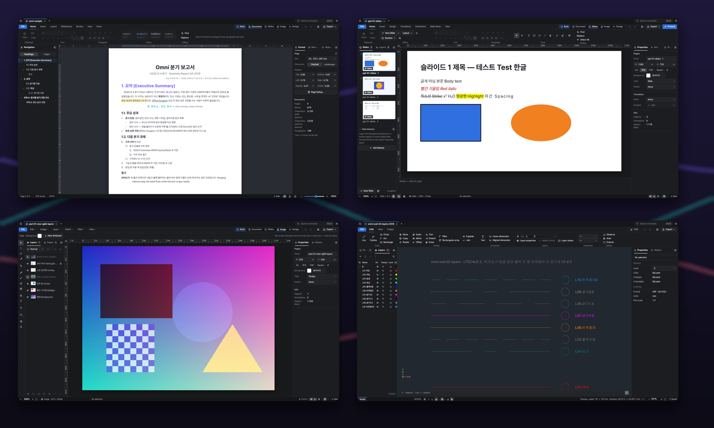
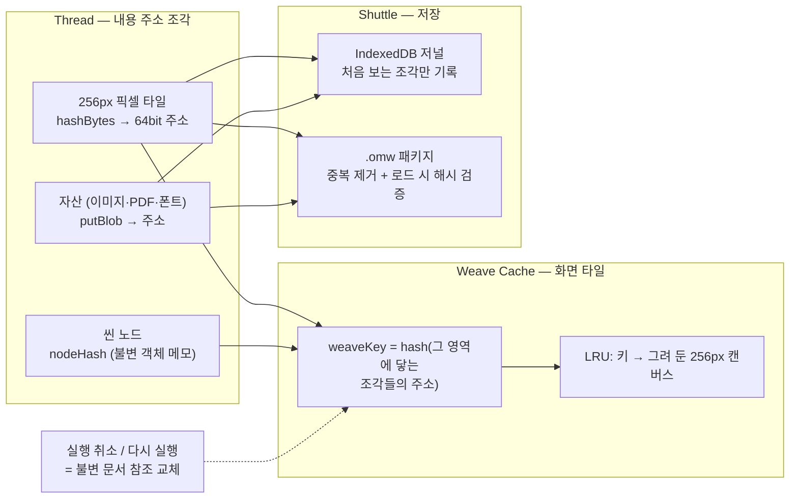

<div align="center">

# Omniweave (오메)

**원본을 깨뜨리지 않는, 설치 파일 약 17 MB의 로컬 6-in-1 편집기 — 파일을 어디에도 올리지 않습니다.**

이미지·벡터(AI)·PDF·문서(DOCX·HWPX)·슬라이드·표, 그리고 PSD와 DWG·DXF 도면까지.
한 캔버스에서 열고, 고치고, 필요한 형식으로 저장합니다.

[**설치 없이 지금 써 보기**](https://wind2sp.github.io/omniweave/app/?demo) · [다운로드](https://wind2sp.github.io/omniweave/download.html) · [English](README.en.md) · [개념](docs/CONCEPT.md) · [Loom 엔진](docs/LOOM.md) · [기여하기](CONTRIBUTING.md)
<!-- 브라우저 데모 링크는 GitHub Pages에 웹 앱이 /app/ 으로 배포된 뒤 동작합니다. 홈페이지 버튼은 website/config.json의 demoPublic으로 켭니다. -->

[](LICENSE)
[](#빠른-시작)
[](https://www.typescriptlang.org/)
[](https://tauri.app/)



</div>

> **상태: 첫 공개 미리보기 (v0.2.0).** 화면 언어는 한국어·English·日本語·简体中文입니다. 중요한 문서는 원본을 따로 보관한 채 써 주세요.
> 아래에는 구현된 것과 **실제로 잰 것**만 적었고, 만들고 있는 것은 **구현 중** · **로드맵**으로 구분했습니다. 한계는 [솔직한 FAQ](#자주-묻는-질문-솔직한-버전)에 먼저 적어 두었습니다.

---

## 말 대신 증거

| | 내용 | 근거 |
|---|---|---|
| **설치 파일 약 17 MB** | Windows x64 설치본 `Omniweave_0.2.0_x64-setup.exe` = 17,464,150바이트 (0.2.0 서명 전 빌드, 업스케일·배경 지우기·글자 인식 AI 모델 포함). 화면은 Windows에 들어 있는 WebView2로 그립니다. | 빌드 산출물 크기, 릴리스마다 달라질 수 있음 |
| **실무 샘플 91개 실측** | 열기 실패·멈춤 **0** — 모두 성공·부분·안내(열 수 없는 이유를 알림) 중 하나 | 출시 전 점검 2026-11-22 (개수만 공개, 파일 내용·이름은 공개하지 않음) |
| **로컬 처리** | 열기·편집·저장·변환·빠른 도구를 모두 내 PC에서 처리합니다. 인터넷은 새 버전 확인(GitHub Releases)에만 씁니다. | 소스 공개 — 직접 확인 가능 |
| **암호 문서 재암호화** | PDF(AES-256) · DOCX/XLSX/PPTX(Office Agile) · `.omw`(AES-256-GCM)를 열고, 고친 뒤 다시 암호화해 저장합니다. 재암호화한 Office 파일이 Microsoft Office 16에서 열리는 것을 확인했습니다. | 구현 완료 |
| **히스토리 타임라인** | 첫 시작부터 모든 명령을 기록하고, 어느 지점이든 미리 보고 한 번에 되돌아갑니다. `.omw`에 함께 저장됩니다. | 구현 완료 |
| **확장자 40여 종** | 문서·표·슬라이드·이미지·PSD·영상·오디오·전자책·텍스트·코드. 형식마다 지원 수준(전체·부분·안내)을 표시합니다. | 구현 완료 |
| **빠른 도구 6종 (로컬)** | PDF 합치기 · PDF 용량 줄이기 · PDF→JPG · 이미지→PDF · 사진 용량 줄이기 · JPG 일괄 변환 | 구현 완료 |
| **원본 무손실 저장** | 고치지 않고 원래 형식으로 저장하면 원본과 같은 바이트, 고친 경우 고친 곳만 다시 씀 | 시험: DOCX·HWPX·XLSX·PPTX·PDF 저장소 견본 전부, PSD 259/259(실무 샘플 3개 중 2개) |
| **Loom 엔진 벤치마크** | 타일 중복 제거 79.5%, 실행 취소 0.08–0.18 ms 등 | [측정값](#측정값), `npm run bench`로 재현 |

"부분"은 일부 내용을 근사하거나 빼고 연 경우(PSD의 일부 효과, PPTX의 일부 도형 등)이고, "안내"는 HEIC 사진·일부 AVI 영상(내장 브라우저 엔진에 디코더 없음), 열기 암호가 필요한 PDF처럼 열 수 없는 이유를 알려 준 경우입니다.

---

## 왜 만들었나

그림 편집기, 일러스트 도구, PDF 편집기, 워드프로세서, 발표 프로그램.
이름도 회사도 다르지만, 안에서 하는 일은 놀랄 만큼 같습니다.

- **이미지와 텍스트를 놓고,**
- **도형과 선을 그리고,**
- **선택한 개체의 속성(위치·크기·색·투명도·글꼴)을 조절합니다.**

"페이지냐 레이어냐", "벡터냐 비트맵이냐"는 **최종적으로 어떤 모양으로 저장하느냐의 차이**일 뿐,
불러와서 편집하는 동안에는 문제가 되지 않습니다. 필요하면 원래 확장자로 다시 내보내면 됩니다.

그런데도 우리는 작업 하나를 끝내려고 프로그램 여섯 개를 오가고, 같은 로고를 여섯 번 복사하고,
같은 문단을 여섯 가지 방식으로 다시 맞춥니다. 그 과정에서 파일을 이 웹사이트 저 웹사이트에 올리고, 원본 서식이 깨집니다.

## 선언

> **파일 형식은 출구일 뿐, 편집은 하나의 씬 그래프에서. 원본은 내 PC에, 원래 모습 그대로.**

1. **하나의 모델.** 래스터 타일, 베지어 패스, 텍스트 문단, 표, PDF 페이지, 이미지·영상이 모두 같은 *씬 그래프 노드*입니다. 선택·이동·투명도·순서·실행 취소가 모든 개체에 똑같이 동작합니다.
2. **형식은 가져오기와 내보내기에서만.** DOCX·HWPX·PDF·PPTX·PSD는 들어올 때 노드로 바뀌고, 나갈 때 다시 그 형식으로 씁니다.
3. **원본을 깨뜨리지 않는다.** 고치지 않은 부분은 원본 그대로 저장하는 것이 원칙입니다(PDF·PSD 구현 중, DOCX·HWPX 로드맵). 지금 잃을 수 있는 것은 [FAQ](#자주-묻는-질문-솔직한-버전)에 공개합니다.
4. **내 파일은 내 PC에.** 변환·압축·병합을 위해 파일을 서버에 올리지 않습니다.
5. **깊이가 승부처.** 여섯 형식을 "열린다" 수준이 아니라 실무에서 쓸 수 있는 깊이로 다루는 것이 목표이며, 구현률은 [docs/coverage](docs/coverage/REPORT.md)에 공개합니다.

자세한 철학과 형식별 매핑 표는 [docs/CONCEPT.md](docs/CONCEPT.md)에 있습니다.

---

## 6-in-1 모듈 (+ PSD)

| 모듈 | 하는 일 (구현됨) |
|---|---|
| **래스터** | 256px 타일 기반 브러시·지우개(필압·경도·불투명도). **PSD** 열기: 픽셀 레이어 + 합쳐진 이미지(효과·조정 레이어·텍스트 엔진 제외). TIFF·WebP·AVIF 등 이미지 열기 |
| **벡터** | 펜(베지어 핸들), 직접 선택, 사각형·타원, 패스파인더 합치기/빼기/교차/제외. **AI** 파일 열기(PDF 호환으로 저장된 파일) |
| **PDF** | pdf.js로 페이지 렌더, 글자를 줄 단위 **편집 가능한 텍스트 개체로 승격**, 암호 PDF 열기·재암호화(AES-256), 빠른 도구(합치기·용량 줄이기·JPG 변환) |
| **문서** | DOCX 문단·글자 서식 열기·저장, 표 개체 편집·DOCX 저장, A4 쪽 나눔. 구형 DOC는 본문·표 텍스트 가져오기 |
| **한글 문서** | HWPX 열기·저장(공개 OWPML 구조 기반 클린룸 구현). 구형 HWP(5.0)는 본문·표 텍스트 가져오기 |
| **슬라이드** | PPTX 열기·저장(텍스트·도형·그림·표·배경), 마스터, 전환 FADE / SLIDE_LEFT / ZOOM, 키프레임 애니메이션, 전체 화면 슬라이드쇼 |

**공통:** 모든 개체에 같은 선택·변형(이동·크기·회전)·불투명도·혼합 모드·잠금·숨기기·순서 변경·실행 취소, 그리고 히스토리 타임라인.
**그 밖에 열 수 있는 것:** XLSX·XLS·CSV(표), Markdown·HTML·EPUB(문서), SRT(자막), 영상·오디오(캔버스·슬라이드쇼 재생), 텍스트·코드·설정 파일.
**내보내기:** PNG · PDF · SVG · DOCX · HWPX · PPTX · XLSX · CSV · Markdown · HTML · SRT · 전용 포맷 `.omw`.
**한글 조판:** `Intl.Segmenter` 그래핌 단위 줄바꿈(자모가 쪼개지지 않음), `keep-all` 어절 단위 줄바꿈.

---

## Loom 엔진

Omniweave의 문서 코어는 직접 만든 **Loom** 엔진입니다. 핵심 아이디어는 하나 — *모든 것을 내용으로 주소 매긴다*.



| 구성 | 무엇을 하나 | 그래서 무엇이 좋은가 |
|---|---|---|
| **Thread** | 픽셀 타일·노드·자산이 각자 64비트 내용 주소를 가짐 (`src/core/hash.ts`, `src/core/loom.ts`) | 같은 타일은 파일에 한 번만 저장. 로드할 때 해시를 다시 계산해 손상된 조각만 건너뛰고 나머지는 엶 |
| **Weave Cache** | 화면 타일의 키 = 그 영역에 닿는 조각들의 주소 해시 (`weaveKey`, `src/render/weave.ts`) | 브러시 한 획은 닿은 화면 타일만 다시 그림. **dirty 플래그·무효화 코드가 없음** → 오래된 픽셀이 남는 종류의 버그가 구조상 생기지 않음. 실행 취소·페이지 왕복 시 예전 타일 재사용 |
| **Shuttle Journal** | IndexedDB에 처음 보는 조각만 증분 기록 (`src/io/journal.ts`) | 자동 저장이 가볍고, 비정상 종료 뒤 복구 가능 |
| **불변 히스토리** | 실행 취소/다시 실행 = 불변 문서 객체 참조 교체 (`src/core/store.ts`) | 픽셀 복사 없음. 비용이 문서 크기와 무관 |

기술 세부와 한계(해시는 비암호학적 64비트 등)는 [docs/LOOM.md](docs/LOOM.md)에 코드 근거와 함께 정리했습니다.

## 측정값

`bench/loom.bench.ts` (Vitest bench, Node, DOM 없는 코드 경로만). **합성 문서**로 잰 값이며 실제 작업 문서와는 다를 수 있습니다.
같은 기기에서 두 번 실행한 평균값의 범위입니다(다른 작업이 함께 돌던 상태라 편차가 큽니다).

- 기기: Intel(R) Core(TM) Ultra 5 125H (18 논리 코어), Windows 11, Node v24.13.1, Vitest 2.1.8
- 재현: `npm run bench`

| 항목 | 조건 | 결과 (평균) |
|---|---|---|
| 타일 해시 `hashBytes` | 256×256 RGBA 타일 1개 (256 KiB) | 0.24–0.25 ms/타일 (약 1 GiB/s) |
| 타일 중복 제거 | 합성 4K 문서: 타일 참조 205개 (흰 바탕 135 + 그림 40 + 같은 도장 30) | 고유 타일 42개 → **타일 데이터 79.5% 제거** |
| 크기 | 같은 문서 | 원시 RGBA 51.3 MiB → 중복 제거 후 10.5 MiB → `.omw` 1.43 MiB |
| `packOmw` | 같은 문서 저장 (zip level 6 포함) | 약 760–780 ms |
| `unpackOmw` | 같은 문서 열기 (**모든 타일 해시 재검증** 포함) | 약 0.1–0.3 s (편차 큼) |
| 왕복 무결성 | 저장 → 열기 | 손상 0 · 누락 0 · 문서 루트 주소 일치 |
| `weaveKey` | 1920×1080 페이지, 화면 타일 40개, 노드 31개 — 한 프레임 전체 키 계산 | 약 0.36–0.43 ms/프레임 |
| `weaveKey` | 위에서 브러시 타일 1개가 바뀐 직후 (새 노드 객체 포함) | 약 0.44 ms/프레임 |
| 실행 취소+다시 실행 | 작은 문서 / 합성 4K 문서 | 0.08–0.09 ms / 0.09–0.18 ms |
| (대조) `structuredClone` | 합성 4K 문서 깊은 복사 — 복사 방식 실행 취소라면 낼 비용 | 24–28 ms |

> 렌더링(캔버스 그리기) 자체는 브라우저가 필요해 이 벤치에 포함하지 않았습니다. 화면 타일 수·캐시 적중률·렌더 시간은 앱 하단 상태 표시줄의 **Loom 미터**(`WeaveStats`)에서 실시간으로 볼 수 있습니다.

---

## 다운로드·설치

[**GitHub 릴리스에서 받기**](https://github.com/wind2sp/omniweave/releases/latest) — Windows 10(버전 2004 이상)·Windows 11, x64. Microsoft Store 판은 준비 중입니다.

| 파일 | 설명 |
|---|---|
| `Omniweave_<버전>_x64-setup.exe` | **설치본(권장).** 관리자 권한 없이 사용자 폴더에 설치하고, 설치할 때 화면 언어를 고릅니다. `.omw` 파일이 연결됩니다. 자동 업데이트됩니다 |
| `Omniweave_<버전>_x64-portable.exe` | 설치 없이 실행. 자동 업데이트됩니다(같은 폴더·같은 이름의 exe를 바꿈) |
| `SHA256SUMS.txt` | 받은 파일 확인용. PowerShell: `Get-FileHash .\Omniweave_<버전>_x64-setup.exe` 값이 이 파일의 값과 같아야 합니다 |

- 화면은 Windows에 들어 있는 WebView2로 그립니다. Windows 11과 최신 Windows 10에는 기본으로 있고, 없으면 설치본이 설치 중에 내려받습니다(인터넷 필요).
- **'Windows의 PC 보호' / '알 수 없는 게시자' 경고:** 아직 코드 서명 인증서가 없어 처음 실행할 때 뜰 수 있습니다. 위 SHA-256으로 파일을 확인한 뒤 **추가 정보 › 실행**을 누르세요. 코드 서명은 준비 중입니다(`docs/CODE_SIGNING.md`).
- **자동 업데이트:** 설치본과 포터블은 실행 4초 뒤와 6시간마다 GitHub 릴리스를 확인하고, 새 버전을 받아 검사(서명, 포터블은 크기·SHA-256·자체 시험도)한 뒤 제목 줄에 알립니다. 알림을 누르면 바뀐 내용을 보여 주고 **지금 업데이트**로 설치하거나 exe를 바꾼 뒤 다시 엽니다. 포터블이 놓인 폴더에 쓸 수 없으면 다운로드 페이지를 엽니다. Microsoft Store 판은 Store가 업데이트하고, 웹(브라우저) 판은 페이지를 새로 고치면 새 판이 됩니다. 업데이트 확인 외에는 인터넷을 쓰지 않습니다([개인정보처리방침](website/privacy.html)).
- **이전 시험판(0.1.13 이하)을 쓰던 PC**는 0.2.0을 한 번 직접 설치해 주세요. 그 뒤부터 자동 업데이트됩니다.
- macOS·Linux 판은 실제 기기에서 확인한 뒤 배포합니다.
## 빠른 시작

필요: Node.js 18 이상. 데스크톱 빌드에는 추가로 [Rust 툴체인](https://www.rust-lang.org/tools/install)과 [Tauri 2 사전 요구사항](https://tauri.app/start/prerequisites/).

```bash
git clone https://github.com/wind2sp/omniweave.git
cd omniweave
npm i

npm run dev          # 웹 브라우저에서 실행 → http://localhost:5199
npm test             # 단위 테스트 (Vitest)
npm run bench        # Loom 엔진 벤치마크

npm run tauri dev    # 데스크톱 앱(개발)
npm run tauri build  # Windows 설치본(NSIS) 생성, .omw 파일 연결 포함
```

## `.omw` 포맷

`.omw`(Omniweave Workspace Package)는 zip 컨테이너입니다. 열 때는 `scene_graph.cbor`와 조각들만 쓰고,
나머지는 다른 도구가 읽을 수 있도록 넣은 **읽기용 사본**입니다 (`src/io/omw.ts`).

```text
document.omw
├── mimetype                    "application/x-omniweave" (무압축, 첫 항목)
├── manifest.json               메타데이터, Loom 루트 주소, 페이지 색인
├── scene_graph.cbor            통합 씬 그래프 (픽셀은 타일 주소로 대체)
├── rasters/<hash>.raw          중복 제거된 256×256 RGBA 타일 (Loom thread)
├── assets/<hash>.<ext>         이미지·PDF·폰트 원본
├── slides/slide_deck.json      슬라이드 순서·전환·애니메이션 (읽기용 사본)
├── slides/master_styles.json   슬라이드 마스터 (읽기용 사본)
├── vectors/paths.json          벡터 노드의 SVG path 데이터 (읽기용 사본)
├── documents/document.xml      모든 텍스트 문단 (읽기용 사본)
└── documents/preview.txt       검색·색인용 일반 텍스트
```

열 때 모든 타일과 자산의 해시를 다시 계산합니다. 맞지 않는 조각은 건너뛰고 개수를 보고하며, 문서의 나머지는 정상적으로 열립니다.

## 단축키

| 동작 | 키 |
|---|---|
| 새 문서 / 열기 / 저장 / 다른 이름으로 저장 | `Ctrl+N` / `Ctrl+O` / `Ctrl+S` / `Ctrl+Shift+S` |
| 도구: 선택 / 직접 선택 / 손 / 브러시 / 지우개 / 펜 / 사각형 / 타원 / 텍스트 | `V` / `A` / `H` / `B` / `E` / `P` / `R` / `O` / `T` |
| 브러시 크기 줄이기 / 키우기 | `[` / `]` |
| 실행 취소 / 다시 실행 | `Ctrl+Z` / `Ctrl+Y` 또는 `Ctrl+Shift+Z` |
| 삭제 / 선택 해제 | `Delete`·`Backspace` / `Esc` |
| 모두 선택 / 복제 | `Ctrl+A` / `Ctrl+D` |
| 앞으로 / 뒤로 / 맨 앞으로 / 맨 뒤로 | `Ctrl+]` / `Ctrl+[` / `Ctrl+Shift+]` / `Ctrl+Shift+[` |
| 굵게 / 기울임 / 밑줄 | `Ctrl+B` / `Ctrl+I` / `Ctrl+U` |
| 화면에 맞춤 / 100% / 확대 / 축소 | `Ctrl+0` / `Ctrl+1` / `Ctrl+=` / `Ctrl+-` |
| 왼쪽 도크 / 오른쪽 도크 | `Ctrl+Alt+1` / `Ctrl+Alt+2` |
| 화면 이동 | `Space` + 드래그, 마우스 휠 (`Shift`+휠 = 가로) |
| 확대/축소 | `Ctrl` + 휠 |
| 선택 개체 미세 이동 | 방향키 (`Shift` = 10px) |
| 펜: 패스 끝내기 / 취소 | `Enter` / `Esc` |
| 텍스트 편집 끝내기 | `Esc` 또는 `Ctrl+Enter` |
| 슬라이드쇼 시작 | `F5` |
| 슬라이드쇼: 다음 / 이전 | `→` `↓` `Space` `Enter` `PageDown` `N` / `←` `↑` `Backspace` `PageUp` `P` |
| 슬라이드쇼: 처음 / 끝 / 나가기 | `Home` / `End` / `Esc` |

> 정의 위치: `src/ui/shell/shortcuts.ts`(전역), `src/ui/CanvasView.tsx`(캔버스), `src/ui/Presenter.tsx`(슬라이드쇼). 글자 입력 중에는 전역 단축키가 동작하지 않습니다(`Ctrl+S` 제외).

---

## 자주 묻는 질문 (솔직한 버전)

**Q. 지금 쓰는 프로그램이 하던 일을 모두 하나요?**
아니요. Omniweave는 "여러 형식을 한 곳에서 다루는 통합 편집기"를 목표로 하고, 승부처는 각 형식을 다루는 **깊이**입니다. 고급 필터, 인쇄 분판, 수식 편집기, 변경 내용 추적 같은 전문 기능은 현재 범위 밖입니다. 형식별 기능 구현률은 [docs/coverage/REPORT.md](docs/coverage/REPORT.md)에 그대로 공개합니다.

**Q. "원본을 깨뜨리지 않는다"는 게 정확히 무슨 뜻인가요?**
방향은 **고치지 않은 부분은 원본 그대로 저장**하는 것입니다. 지금 상태를 나누면:
- **구현 중:** PDF·PSD의 원본 보존 저장 (고친 레이어·페이지만 다시 쓰고 나머지는 원본 바이트 그대로).
- **로드맵:** DOCX·HWPX의 원본 보존(패스스루) 저장.
- **지금:** DOCX·HWPX로 저장하면 Omniweave가 이해한 내용(문단·글자 서식·표 개체)으로 **새 문서를 씁니다.** 각주·머리말 같은 요소는 사라질 수 있습니다.
- 암호가 걸린 문서는 저장할 때 다시 암호화합니다.

**Q. 파일을 정말 어디에도 올리지 않나요?**
네. 열기·편집·저장·변환과 빠른 도구는 모두 내 PC에서 처리하고, 자동 저장 저널도 로컬에 기록합니다. 인터넷 연결은 새 버전 확인(GitHub Releases)에만 씁니다. 홈페이지에도 추적·분석 스크립트가 없습니다. 소스가 공개되어 있으니 직접 확인할 수 있습니다.

**Q. DOCX·HWPX를 열면 원본과 똑같이 보이나요?**
가깝게 보이도록 문단·글자 서식, 표, 그림, 구역·머리글/바닥글, 목록·개요 번호, 메모·변경 추적을 원본의 쪽 나눔에 맞춰 다시 배치합니다(실무 샘플 DOCX 3쪽의 화면 유사도 SSIM 평균 0.969). 그래도 다를 수 있는 것:
- PC에 없는 글꼴을 쓰는 문서는 줄·쪽 나눔이 달라질 수 있습니다.
- 수식, 일부 그리기 개체·글상자. 구형 DOC의 그리기 개체·글상자·OLE 개체는 가져오지 않고 열 때 알려 줍니다.
- 고치지 않고 원래 형식으로 저장하면 원본과 같은 바이트로 저장하므로, 화면 차이가 저장 결과를 바꾸지는 않습니다.

**Q. PDF를 편집할 수 있나요?**
페이지는 그대로 렌더되고, "텍스트 승격"을 하면 글자가 **줄 단위 텍스트 개체**가 되어 고칠 수 있습니다. 원래 글자는 표본 추출한 배경색 사각형으로 덮습니다. 복잡한 배경 위 글자, 다단·표의 재배치는 아직 안 됩니다.
PDF 내보내기는 글자·도형이 살아 있는 벡터 PDF입니다.

**Q. PPTX·구형 HWP·PSD는 어디까지 되나요?**
- **PPTX:** 텍스트·도형·그림(EMF·WMF 포함)·표·차트·배경을 슬라이드로 열고 PPTX로 저장합니다. 고치지 않으면 원본 바이트 그대로 저장합니다. 일부 도형은 근사하며, 모핑·동영상 효과·경로 애니메이션은 지원하지 않습니다.
- **구형 HWP(5.0)·DOC·PPT·XLS:** 서식째 엽니다. DOC·XLS·PPT는 본문 글·칸 값·슬라이드 글만 고친 경우 같은 형식으로 저장하고, 그 밖의 편집은 DOCX·XLSX·PPTX로 저장하도록 안내합니다.
- **PSD:** 레이어·조정 레이어·효과를 화면에 그리고, CMYK(ICC 색 관리)·16비트를 지키며, 고급 개체는 새 탭에서 열어 고칠 수 있습니다. 고치지 않고 PSD로 저장하면 원본 바이트를 그대로 씁니다.

**Q. 설치 없이 써 볼 수 있나요?**
같은 앱이 웹 브라우저에서 실행됩니다. 브라우저 데모(`app/?demo`)는 GitHub Pages 배포 후 [여기](https://wind2sp.github.io/omniweave/app/?demo)에서 열 수 있고, 데모도 파일을 서버로 보내지 않고 브라우저 안에서 처리합니다. 소스에서 직접 실행하려면 [빠른 시작](#빠른-시작)을 보세요.

**Q. 설치할 때 경고가 떠요.**
현재 빌드는 **코드 서명 전**이라 Windows SmartScreen이 처음 실행을 막을 수 있습니다. 다운로드 페이지에 SHA-256으로 파일을 확인하는 방법을 적었습니다. 코드 서명은 로드맵에 있습니다.

**Q. 패스파인더 결과가 각져 보여요.**
불리언 연산은 곡선을 잘게 펼친 다각형(`polygon-clipping`)으로 계산하므로, 결과 패스는 곡선 핸들 대신 촘촘한 직선 기준점이 됩니다.

**Q. 빠르다고 하던데, GPU를 쓰나요?**
아직은 **Canvas 2D + TypeScript**입니다. WebGPU 렌더러와 Rust/WASM 코어는 로드맵입니다. 현재의 성능 이점은 GPU가 아니라 "바뀐 것만 다시 그리고 다시 저장하는" Loom 구조에서 나옵니다. 측정값은 [위 표](#측정값)가 전부입니다.

**Q. 영어 화면이 있나요? macOS·Linux는요?**
앱 UI는 한국어·영어·일본어·중국어(간체)를 지원합니다(설치할 때 고르고 환경 설정에서 바꿈). 홈페이지도 네 언어로 볼 수 있습니다. macOS·Linux 빌드는 실제 기기에서 확인하기 전까지 배포하지 않습니다.

---

## 로드맵

구현 완료
- [x] 통합 씬 그래프 (래스터·벡터·텍스트·표·이미지·영상·PDF 노드)
- [x] Loom: 내용 주소 타일, Weave Cache, `.omw` 중복 제거·무결성 검증, IndexedDB 저널
- [x] 래스터 브러시/지우개, 벡터 펜·도형·패스파인더, PSD·AI 열기
- [x] PDF 렌더 + 텍스트 승격, 빠른 도구 6종 (로컬)
- [x] DOCX·HWPX 문단 단위 열기·저장, 표 개체, A4 쪽 나눔, 구형 DOC·HWP·PPT·XLS 텍스트 가져오기
- [x] PPTX 열기·저장, 슬라이드 마스터·전환·키프레임 애니메이션·슬라이드쇼
- [x] 암호 문서: PDF(AES-256)·Office Agile·`.omw`(AES-256-GCM) 열기·재암호화
- [x] 작업 히스토리 타임라인
- [x] 확장자 40여 종 열기
- [x] Windows 데스크톱(Tauri 2, 설치 파일 약 17 MB, `.omw` 연결, 설치본·포터블 자동 업데이트) + 웹 실행

구현 중
- [ ] 원본 무손실 저장 — PDF·PSD (고치지 않은 부분은 원본 바이트 그대로)
- [ ] 글자가 살아 있는 PDF 내보내기
- [ ] 브라우저 데모 공개 (GitHub Pages `/app/?demo`)

계획 (순서는 바뀔 수 있음)
- [x] 영어·일본어·중국어(간체) UI
- [ ] 첫 공개 릴리스 v0.1.0
- [ ] DOCX·HWPX 원본 보존(패스스루) 저장
- [ ] DOCX·HWPX 안의 표를 표 구조로 가져오기, 문서 속 그림 가져오기
- [ ] 코드 서명된 설치본
- [ ] 패스파인더 결과의 곡선 복원
- [ ] WebGPU 렌더러 · Rust/WASM 코어 이관
- [ ] macOS / Linux 정식 지원

## 기여

이슈와 PR을 환영합니다. 특히 **실제 파일에서 깨지는 사례**(민감 정보를 지운 샘플)가 큰 도움이 됩니다.
개발 환경, 커밋 규칙, 클린룸 원칙은 [CONTRIBUTING.md](CONTRIBUTING.md)를 봐 주세요.

## 라이선스 · 클린룸 · 상표

- **라이선스:** [GPL-3.0-or-later](LICENSE) (GNU 일반 공중 사용 허가서 3판 또는 그 이후 판). 소프트웨어는 "있는 그대로" 제공되며 어떠한 보증도 하지 않습니다. 수정본을 배포할 때는 같은 라이선스로 소스코드를 함께 공개해야 합니다.
- **저작권:** Copyright (C) 2026 NINEROW partners Co., Ltd. (나인로우파트너스(주)) and Omniweave contributors. Director: 황경진 Kyeongjin Hwang · Contact: wind2sp@9rowpar.com. 자세한 내용은 [NOTICE](NOTICE)를 보세요.
- **클린룸 원칙:** 타사 상용 프로그램의 바이너리를 리버스 엔지니어링하지 않습니다. 공개 표준과 공개 문서(ISO 32000 PDF, ECMA-376 Office Open XML, [MS-DOC]·[MS-PPT]·[MS-XLS] 공개 사양, KS X 6101 HWPX/OWPML, 한글과컴퓨터가 공개한 HWP 5.0 문서 형식, Adobe가 공개한 Photoshop File Formats Specification 등)만을 근거로 구현합니다.
- **상표:** Omniweave™ and the Omniweave logo are trademarks of the project's copyright holder. Microsoft, Windows, Word, Excel, PowerPoint, Office, WebView2 and Edge are trademarks of Microsoft Corporation. Adobe, Photoshop, Illustrator, Acrobat and PostScript are registered trademarks or trademarks of Adobe Inc. Hangul (한글), Hancom and HWP are trademarks of Hancom Inc. AutoCAD, Autodesk and DXF are registered trademarks or trademarks of Autodesk, Inc. in the USA and other countries; "DWG" names the drawing file format. ACIS is a trademark of Spatial Corp. All other names are the property of their owners. Omniweave is not affiliated with, sponsored or endorsed by any of these companies; their names are used only to describe file compatibility. Omniweave 이름·로고 사용 규칙과 다른 회사 상표 목록은 [TRADEMARKS.md](TRADEMARKS.md)를 보세요.
- **사용한 오픈소스:** pdf.js, pdf-lib, fflate, cbor-x, polygon-clipping, immer, zustand, React, Tauri, Pretendard 글꼴(SIL OFL) — 각 라이선스를 따릅니다. 전체 목록과 라이선스 전문은 [THIRD_PARTY_NOTICES.md](THIRD_PARTY_NOTICES.md)에 있습니다.
